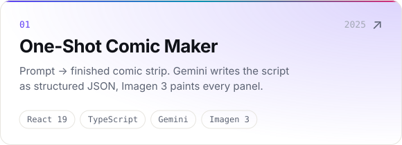
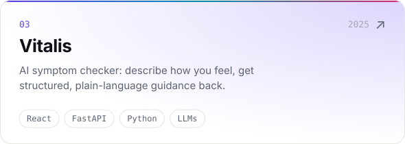
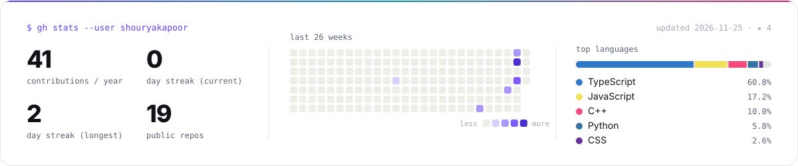

<div align="center">

<picture>
  <source media="(prefers-color-scheme: dark)" srcset="assets/hero-dark.svg">
  
</picture>

<br><br>

<a href="https://shouryakapoor.github.io"></a>
<a href="https://linkedin.com/in/shouryakapoor/"></a>
<a href="mailto:shouryakapoorapps@gmail.com"></a>
<a href="https://instagram.com/shouryyakapoor"></a>

</div>

<br>

### `01` &nbsp;about

I build software that puts AI to real work: agent pipelines, RAG systems, and the full-stack apps around them. Right now I'm doing an **MSc in Computer Science (Intelligent Systems) at Trinity College Dublin**.

Before Trinity I was at **Kusum Healthcare**. I started as a software developer intern shipping internal portals in Next.js and Postgres, then became **Project Lead** for an org-wide document management rollout that I initiated, onboarding 100+ users.

```yaml
now:
  studying:  MSc CS · Intelligent Systems @ Trinity College Dublin
  building:  a multi-agent disaster-response simulator with RAG
  tinkering: MiniGPT, a small GPT written from scratch in PyTorch
  research:  dissertation comparing REST API testing tools
  open_to:   internships · graduate roles · part-time work in Dublin
```

<br>

### `02` &nbsp;selected work

<div align="center">
<a href="https://github.com/vanepoint-hq/vanepoint"><picture><source media="(prefers-color-scheme: dark)" srcset="assets/card-vanepoint-dark.svg"></picture></a>
<a href="https://github.com/ShouryaKapoor/AI-Comic-Maker"><picture><source media="(prefers-color-scheme: dark)" srcset="assets/card-comic-dark.svg"></picture></a>
<a href="https://github.com/ShouryaKapoor/Vitalis-AI-Symptom-Check"><picture><source media="(prefers-color-scheme: dark)" srcset="assets/card-vitalis-dark.svg"></picture></a>

<sub>more on <a href="https://github.com/ShouryaKapoor?tab=repositories">my repositories</a>: Likho, Distill-it, Flex, Scriptify, NavSwift</sub>
</div>

<br>

### `03` &nbsp;toolkit

<picture>
  <source media="(prefers-color-scheme: dark)" srcset="assets/toolkit-dark.svg">
  
</picture>

<br>

### `04` &nbsp;activity

<div align="center">
<picture>
  <source media="(prefers-color-scheme: dark)" srcset="assets/stats-dark.svg">
  
</picture>

<picture>
  <source media="(prefers-color-scheme: dark)" srcset="https://raw.githubusercontent.com/ShouryaKapoor/ShouryaKapoor/output/snake-dark.svg">
  
</picture>
</div>

<br>

<div align="center">
<sub><code>150+ LeetCode</code> · <code>Smart India Hackathon finalist</code> · <code>Tata Imagination Challenge '24 semi-finalist</code> · <code>Claude 101 certified</code></sub>
<br><br>
<sub>stats and snake are redrawn daily by <a href=".github/workflows/profile.yml">a GitHub Action</a>, no third-party cards</sub>
</div>
